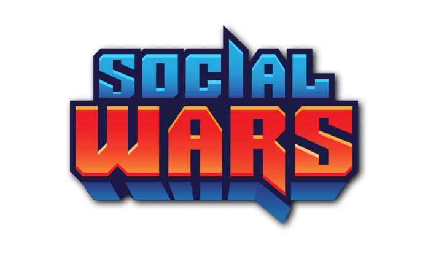

<div align="center">
  
  <h1>⚔️ Social Wars: Reborn ⚔️</h1>
  <p><b>The Complete Open-Source Game Server & Modern Development Platform for Social Wars</b></p>
</div>

---

## 🌟 About the Project

**Social Wars: Reborn** is an open-source development and preservation initiative for the classic Facebook strategy game *Social Wars* (originally by Social Point). 

Unlike pre-bundled binary packages, this repository contains the **complete Python source code** for the local backend server, game engine, and API emulator, along with all original Flash assets, configurations, mod support, and quest maps.

---

## 🚀 Key Features & Capabilities

- 🐍 **Full Python Source Code:** Complete game backend powered by Flask (`server.py`, `engine.py`, `command.py`, `sessions.py`).
- 🛠️ **Developer & Modding Friendly:**
  - Easy unit rebalancing and stat customization via `config/patch/unit_patch.json`.
  - Built-in Modding system in `mods/`.
  - Custom campaigns, enemy villages, and quests in `villages/`.
  - Developer patch-generation tools in `tools/`.
- 💾 **Local Offline Play:** Run and play the game entirely offline on your own machine.
- 🌐 **Modern Web Interface:** Clean HTML/CSS template frontend for account management and game embedding.

---

## 💻 Quick Start Guide

### 1. Requirements
* Python 3.9+ (Tested on Python 3.10, 3.11, 3.15)
* Install Python dependencies:
```bash
pip install -r requirements.txt
```

### 2. Run the Game Server
Launch the server using Python:
```bash
python server.py
```
*(By default, the server runs on `http://127.0.0.1:5055/`)*

Options:
```bash
python server.py --host 127.0.0.1 --port 5055
```

### 3. Play the Game
Open any Flash-compatible browser and navigate to:
```
http://127.0.0.1:5055/
```

> **Recommended Browsers:**
> - [FlashBrowser](https://github.com/radubirsan/FlashBrowser/releases/latest) (Standalone, no external Flash plugin needed)
> - [Basilisk Browser](https://www.basilisk-browser.org/) (with Adobe Flash NPAPI 32.0.0.371)
> - Check [FLASH.md](FLASH.md) for detailed browser setup instructions.

---

## 📂 Repository Structure

```
social-wars-reborn/
├── assets/          # Flash client (.swf) files, sounds, unit models, sprites
├── config/          # Game configurations, item catalogs, unit balance patches
├── mods/            # Modding system (no-hiring, resource modifications, etc.)
├── stub/            # Flash crossdomain policy and sandbox helpers
├── templates/       # Web UI templates (login.html, play.html, CSS styles)
├── tools/           # Unit patch generator & Atom Fusion tools
├── villages/        # Quest definitions and static NPC village maps
├── server.py        # Main HTTP & Flash API server (Flask)
├── engine.py        # Game logic processing and calculations
├── command.py       # Player action commands handler (build, train, attack)
├── sessions.py      # Player profile, village state, and save manager
├── constants.py     # Game constants, resource IDs, and item definitions
└── requirements.txt # Python package requirements
```

---

## 📜 License
This project is licensed under the GNU General Public License v3.0 - see the [LICENSE](LICENSE) file for details.
All original Social Wars Flash game assets belong to Social Point. This project is created for educational, preservation, and non-commercial purposes.
